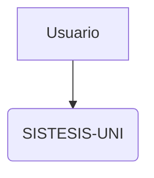
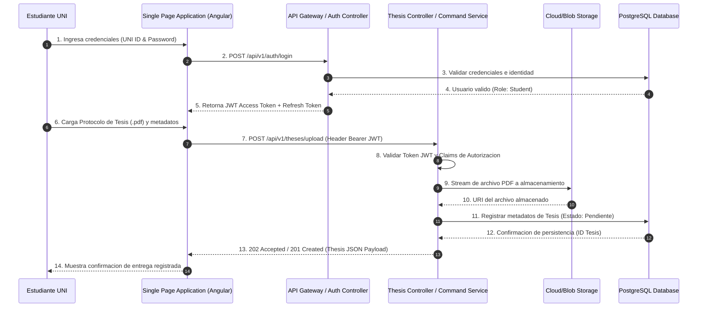
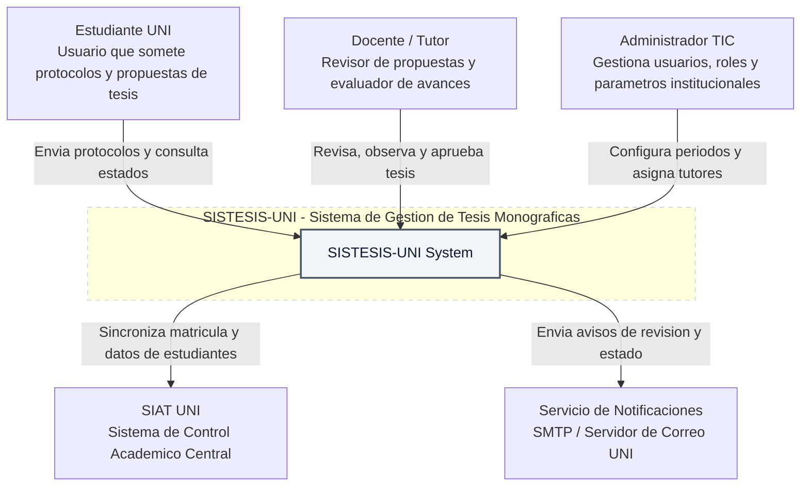
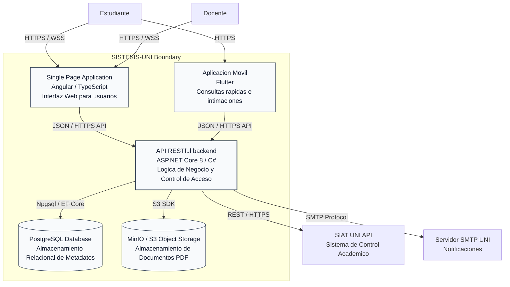
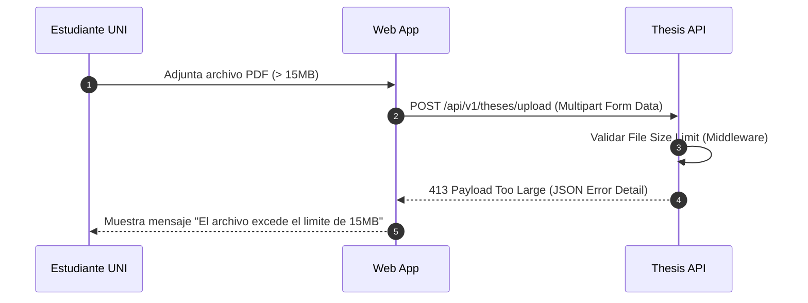
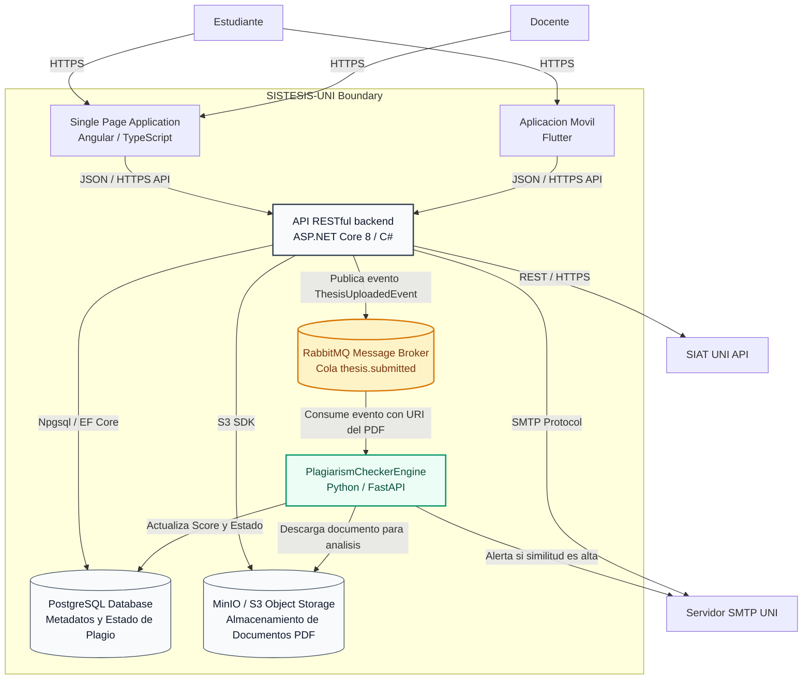

# 2. Guía de Renderizado y Explotación con Mermaid Live Editor

Uso de Mermaid.js para modelar arquitectura mediante código en repositorios y editores web[cite: 1].

### 2.1 Paso a Paso para la Creación y Exportación
1. Ingrese al entorno en línea a través de [Mermaid Live Editor](https://mermaid.live)[cite: 1].
2. Copie el código Mermaid del diagrama y péguelo en el panel izquierdo (Code Editor)[cite: 1].
3. Verifique la vista previa interactiva en el panel derecho (Preview)[cite: 1].
4. En el menú inferior **Actions**, seleccione **PNG** para documentación digital o **SVG** para formato vectorial imprimible[cite: 1].
5. Puede copiar el enlace codificado mediante el botón **Copy Link to Clipboard**[cite: 1].

### 2.2 Inclusión en Repositorios GitHub (README.md)
GitHub renderiza nativamente bloques Mermaid utilizando el bloque de código correspondiente[cite: 1]:

---

# 3. Especificación de Diagramas Mermaid.js

### 3.1 Diagrama de Secuencia API-First (Autenticación JWT y Carga Asíncrona)
Flujo cronológico de autenticación, validación de token y persistencia del documento[cite: 1].

---

### 3.2 Diagrama de Contexto C4 (Nivel 1)
Fronteras del sistema SISTESIS-UNI, usuarios principales y sistemas externos[cite: 1].

---

### 3.3 Diagrama de Contenedores C4 (Nivel 2)
Topología de ejecución, aplicaciones cliente, API backend, bases de datos y almacenamiento[cite: 1].

---

# 5. Guía de Ejercicios Propuestos y Resueltos

### Ejercicio 1: Modelado de Manejo de Errores en Secuencia
Manejo cuando un estudiante sube un archivo PDF con un tamaño superior al límite permitido (15 MB)[cite: 1].

---

### Ejercicio 2: Inclusión de Microservicio de Anti-Plagio
Extensión de contenedores C4 incluyendo RabbitMQ y el motor `PlagiarismCheckerEngine` (Python/FastAPI) con actualización asíncrona en PostgreSQL[cite: 1].

