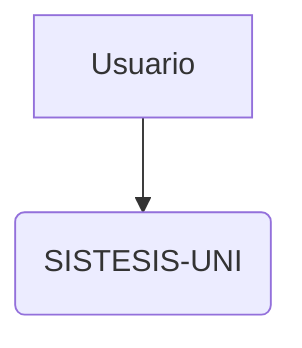
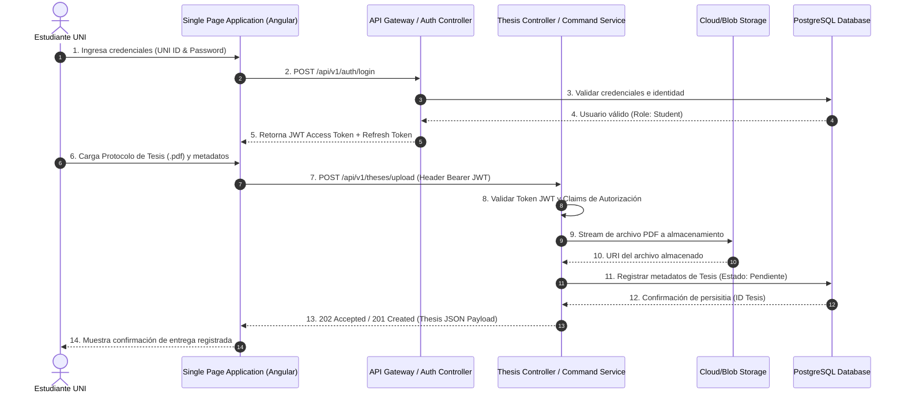
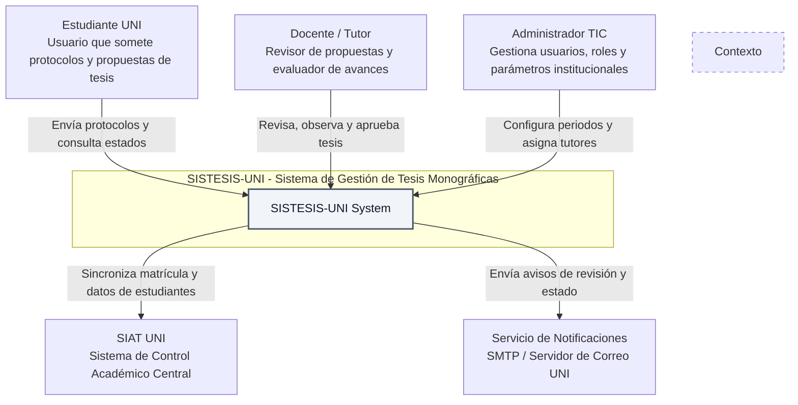
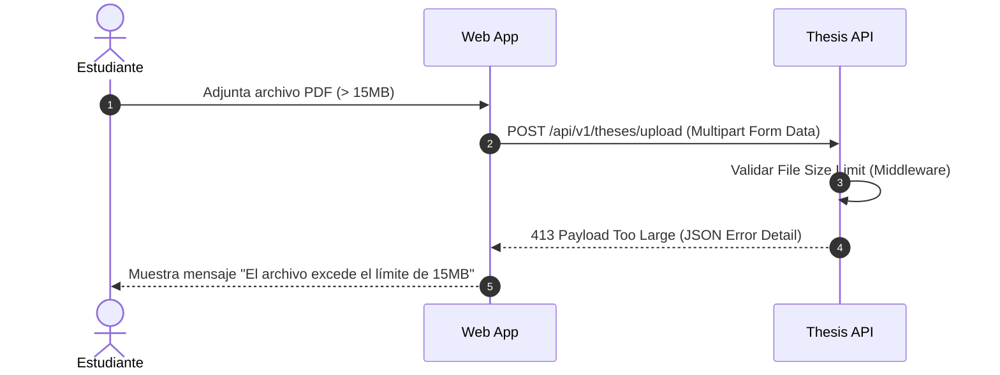

# SISTESIS-UNI: Especificación Arquitectónica y Modelado C4

Este repositorio contiene la especificación arquitectónica formal, diagramas cronológicos de integración API-First, modelos C4 (Nivel 1 y Nivel 2) y resolución de ejercicios de diseño para el **Sistema de Gestión de Tesis Monográficas (SISTESIS-UNI)** de la Universidad Nacional de Ingeniería.

---

## 2. Guía de Renderizado y Explotación con Mermaid.js

Para asegurar que los modelos arquitectónicos evolucionen junto con el código fuente y puedan auditarse en sistemas de control de versiones (Git), todo el diseño se gestiona como **Architecture as Code (AaC)** mediante Mermaid.js.

### 2.1 Paso a Paso para la Creación y Exportación
1. **Acceso al editor:** Ingrese al entorno web en [Mermaid Live Editor](https://mermaid.live).
2. **Edición:** Copie el bloque de código Mermaid de cualquiera de los diagramas de este repositorio y péguelo en el panel izquierdo (*Code Editor*).
3. **Previsualización:** Compruebe la sintaxis e interactividad en el panel derecho (*Preview*).
4. **Exportación de artefactos:**
   - Despliegue el menú **Actions** en la barra inferior.
   - Seleccione **PNG** para insertar en documentación ofimática digital (Word / PDF).
   - Seleccione **SVG** para documentación vectorial de alta resolución e impresión formal.
   - También puede compartir el diagrama interactivo seleccionando **Copy Link to Clipboard**.

### 2.2 Inclusión Nativa en Repositorios GitHub
GitHub soporta la renderización nativa de diagramas Mermaid en archivos `.md`. Simplemente encierre la definición con la etiqueta correspondiente:

```text

```

---

## 3. Especificación de Diagramas Mermaid.js

### 3.1 Diagrama de Secuencia API-First (Autenticación JWT y Carga Asíncrona)
Modela el flujo de interacción cronológico para el inicio de sesión de estudiantes y la sumisión de protocolos de tesis mediante tokens JWT y almacenamiento desacoplado:



---

### 3.2 Diagrama de Contexto C4 (Nivel 1)
Delimita las fronteras del sistema SISTESIS-UNI, sus usuarios principales y los sistemas externos institucionales con los que interactúa:



---

### 3.3 Diagrama de Contenedores C4 (Nivel 2)
Expone la topología de contenedores de software, frameworks tecnológicos y protocolos de comunicación utilizados en SISTESIS-UNI:


---

## 5. Guía de Ejercicios Propuestos y Resueltos

### Ejercicio 1 (Resuelto): Manejo de Errores en Secuencia (Límite de Archivo > 15 MB)
**Enunciado:** Diseñe la interacción cuando un estudiante sube un archivo PDF con un tamaño superior al límite permitido (15 MB).

**Solución Mermaid:**


---

### Ejercicio 2 (Resuelto): Inclusión de Microservicio de Anti-Plagio
**Enunciado:** Extienda el Diagrama de Contenedores C4 (Sección 3.3) incluyendo un nuevo contenedor llamado `PlagiarismCheckerEngine` (Python/FastAPI) que procesa los documentos asíncronamente mediante una cola de mensajes en RabbitMQ.

**Requisitos resueltos:**
1. Incorporación del broker de mensajería RabbitMQ recibiendo eventos desde la API central.
2. Comunicación desacoplada entre RabbitMQ y el motor de análisis anti-plagio (`PlagiarismCheckerEngine`).
3. Actualización asíncrona del estado del dictamen y porcentaje de similitud en PostgreSQL.

**Solución Mermaid:**
```mermaid
graph TB
    subgraph SISTESIS [SISTESIS-UNI Boundary - Pipeline Asíncrono de Anti-Plagio]
        SPA[Single Page Application<br/>Angular / TypeScript<br/>Interfaz Web de Gestión]
        MobileApp[Aplicación Móvil<br/>Flutter<br/>Consultas de Avance]
        API[API RESTful backend<br/>ASP.NET Core 8 / C#<br/>Lógica de Negocio y Publicador]
        DB[(PostgreSQL Database<br/>Metadatos, Tesis y Score de Plagio)]
        BlobStorage[(MinIO / S3 Object Storage<br/>Almacén Central de Archivos PDF)]
        
        %% Componentes incorporados en el Ejercicio 2
        RabbitMQ[(RabbitMQ Message Broker<br/>Cola de Mensajes: thesis.submitted)]
        PlagiarismEngine[PlagiarismCheckerEngine<br/>Python / FastAPI<br/>Procesamiento NLP y Detección de Similitud]
    end

    SIAT_Ext[SIAT UNI API<br/>Control Académico]
    SMTP_Ext[Servidor SMTP UNI<br/>Notificaciones de Alerta]

    %% Flujos de usuario
    Estudiante -->|HTTPS| SPA
    Docente -->|HTTPS| SPA
    Estudiante -->|HTTPS| MobileApp
    SPA -->|JSON / HTTPS API| API
    MobileApp -->|JSON / HTTPS API| API

    %% Flujo de persistencia y cola
    API -->|Npgsql / EF Core| DB
    API -->|S3 SDK (Carga inicial)| BlobStorage
    API -->|Publica evento: ThesisUploadedEvent| RabbitMQ

    %% Flujo Asíncrono del Microservicio Anti-Plagio
    RabbitMQ -->|Consume evento de nueva tesis| PlagiarismEngine
    PlagiarismEngine -->|Lee y descarga PDF para análisis| BlobStorage
    PlagiarismEngine -->|Actualiza estado y % de similitud| DB
    PlagiarismEngine -.->|Alerta si similitud > 20%| SMTP_Ext

    %% Integraciones externas
    API -->|REST / HTTPS| SIAT_Ext
    API -->|SMTP Protocol| SMTP_Ext

    style PlagiarismEngine fill:#ecfdf5,stroke:#059669,stroke-width:2px,color:#064e3b
    style RabbitMQ fill:#fef3c7,stroke:#d97706,stroke-width:2px,color:#78350f
    style API fill:#f8fafc,stroke:#334155,stroke-width:2px,color:#0f172a
    style DB fill:#f8fafc,stroke:#334155,stroke-width:1px,color:#0f172a
    style BlobStorage fill:#f8fafc,stroke:#334155,stroke-width:1px,color:#0f172a
```